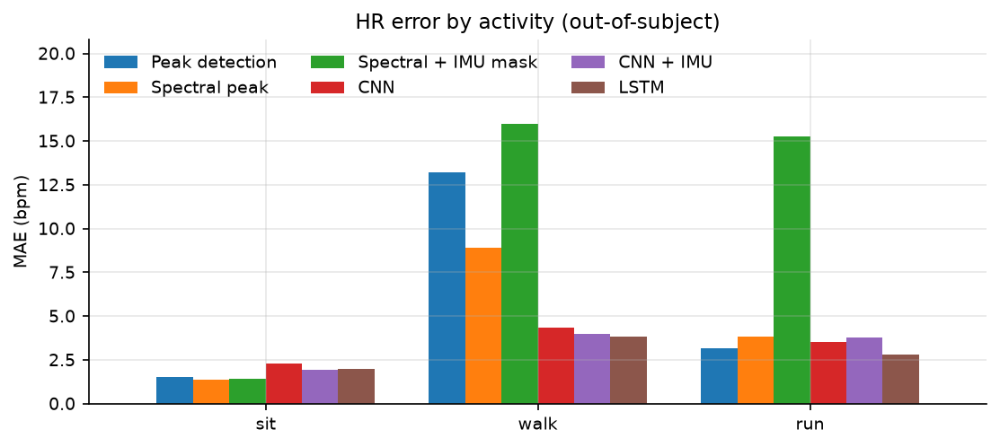
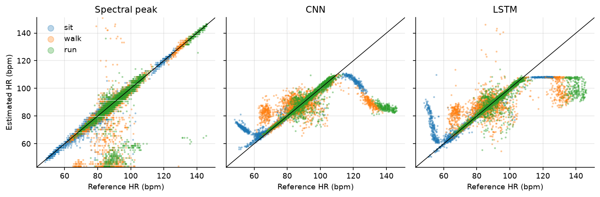

# Heart rate from finger PPG under motion

Estimating heart rate from PPG while people sit, walk and run in place, using the open [PhysioNet Pulse Transit Time PPG dataset](https://physionet.org/content/pulse-transit-time-ppg/1.1.0/). Simple signal processing is compared with small neural networks (CNN, LSTM), evaluated subject-wise against ECG, with a look at where motion breaks things and an int8 TFLite export of the CNN.



## Data

22 healthy subjects, three activities (sit, walk in place, run in place), about 8 min each, everything sampled at 500 Hz. Used here: the green PPG channel (`pleth_3`), the finger-clip accelerometer, and the annotated ECG R-peaks as reference.

Where the docs don't match the data:
- accelerometer is in m/s², not g (magnitude ~9.6 at rest)
- raw PPG is inverted (received light); verified with ECG-triggered averages
- the dataset README contradicts itself on red/IR channels, so green is used

## Method

- PPG: invert, band-pass 0.5–4 Hz, decimate to 50 Hz. Accelerometer: median filter, decimate.
- 8 s windows with 2 s step. Reference HR = mean ECG RR interval in the window (15 of 15,984 windows dropped for irregular annotations).
- DSP baselines: **peak detection**, **spectral peak**, and **spectral + IMU mask** (discard PPG peaks that coincide with the two strongest accelerometer peaks).
- Networks: **CNN** (4 conv blocks, 21.7k params), **CNN + IMU** (same, with 3 accelerometer channels), **LSTM** (LSTM(32) after 4× pooling, 4.9k params). L1 loss, early stopping.

**Leakage:** windows overlap and HR is stable within a person, so everything is split by subject (5-fold CV, each subject tested once). Inputs are normalised per window, int8 calibration uses training subjects only, and the DSP parameters were fixed up front. The one change after the first run was a bug in the IMU mask, found by a unit test; the fixed version performs worse and is reported as is.

## Results

Out-of-subject MAE in bpm over 15,969 windows:

| Method | MAE | RMSE | sit | walk | run | median per subject |
|---|---|---|---|---|---|---|
| Peak detection | 5.95 | 15.38 | 1.53 | 13.19 | 3.18 | 2.76 |
| Spectral peak | 4.71 | 12.64 | 1.38 | 8.91 | 3.85 | 2.38 |
| Spectral + IMU mask | 10.89 | 28.11 | 1.43 | 15.98 | 15.26 | 9.14 |
| CNN | 3.39 | 9.50 | 2.30 | 4.36 | 3.51 | 1.00 |
| CNN + IMU | 3.24 | 8.60 | 1.94 | 4.00 | 3.77 | 1.20 |
| LSTM | 2.86 | 7.93 | 1.98 | 3.83 | 2.78 | 0.66 |

Findings:

- **Walking is harder than running** for all DSP methods. The peak detector counts motion bumps as beats (+10.8 bpm bias while walking). Why walking is worse than running in this setup is still unclear.
- **Spectral errors follow the movement:** 75 % (run) / 50 % (walk) of large spectral errors sit on an accelerometer peak, vs. 15 % chance.
- **The IMU mask makes things worse.** In ~15 % of moving windows an accelerometer peak lies near the true HR, so the right peak gets thrown away and the estimate jumps to the second harmonic (54–68 % of its large errors are at ~2× HR). It would need tracking across windows to work.
- **The networks fail on unusual subjects.** Subject 2 has a mean HR of 130 bpm; CNN and LSTM predict ~94 and ~103 and saturate around 108 bpm, i.e. they regress to the training range. DSP gets ~1 bpm on the same subject. 12–14 training subjects per fold do not cover enough HR range.
- Differences between the networks are small compared to the fold-to-fold spread (test MAE 0.5–10.2 bpm), so they shouldn't be ranked. Three LSTM folds hit the epoch limit, so it may be undertrained.



Per-subject and per-activity tables, the error analysis, and an SQI (spectral purity) coverage table are in [results/tables/](results/tables/).

## TFLite export

The fold-0 CNN was exported to TFLite with full int8 quantization (calibrated on training subjects only). The model is 34 KB and the test MAE goes from 2.96 to 3.00 bpm. It was not run on an actual microcontroller.

## Limitations

- Finger clip in a lab, walking/running in place. Not a wrist or in-ear device.
- 22 healthy subjects; large variance between folds.
- Zero-phase filtering and independent windows, so not real-time as is.
- The DSP baselines are deliberately simple (no TROIKA-style tracking).

## Run it

Python 3.11, CPU only.

```bash
pip install -r requirements.txt && pip install -e .
python scripts/download_data.py    # ~420 MB, checksummed
python scripts/make_windows.py
python scripts/explore_data.py
python scripts/run_baseline.py
python scripts/train.py
python scripts/evaluate.py
python scripts/export_tflite.py
pytest
```

Parameters are in [configs/default.yaml](configs/default.yaml).

## Possible next steps

- Time-stretch augmentation to cover a wider HR range
- Tracking across windows / falling back to DSP when the network is out of range
- HRV from detected beats

## References

- Mehrgardt, P., Khushi, M., Poon, S., & Withana, A. (2022). Pulse Transit Time PPG Dataset (version 1.1.0). PhysioNet. https://doi.org/10.13026/jpan-6n92
- Zhang, Z., Pi, Z., & Liu, B. (2015). TROIKA: A general framework for heart rate monitoring using wrist-type photoplethysmographic signals during intensive physical exercise. *IEEE TBME* 62(2), 522–531.

## License

Code: MIT (see [LICENSE](LICENSE)). The dataset is not included; it is published by PhysioNet under the Open Data Commons Open Database License v1.0 and is downloaded by `scripts/download_data.py`.
